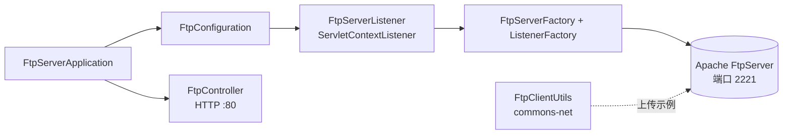

<div align="center">

# springboot-ftp-server

**A lightweight, embedded FTP file server built on Spring Boot 2 and Apache FtpServer — start, store, and serve files with zero external FTP daemon.**

[](LICENSE)
[](https://www.java.com/)
[](https://spring.io/projects/spring-boot)
[](https://maven.apache.org/)
[](https://github.com/javaeer/springboot-ftp-server/releases)

</div>

---

## 📖 简介 / Introduction

`springboot-ftp-server` 是一个**基于 Spring Boot 2 的嵌入式 FTP 文件服务器**，底层使用 [Apache FtpServer](https://mina.apache.org/ftpserver-project/)。应用随 Spring Boot 一同启动即自动拉起一个 FTP 服务，无需额外部署 FTP 守护进程，适合作为**轻量级文件 / 图片存储与分发后端**，配合 Nginx 即可对外提供 HTTP 访问。

- 🚀 **嵌入式**：随 Spring Boot 应用启动 / 停止，无独立 FTP 进程
- 🖥 **跨平台根目录**：自动识别 Windows / macOS / Linux 并设置文件根目录
- 🔌 **被动模式**：预置 `10000–10500` 被动端口区间，便于云服务器放行
- 👤 **内置账号**：默认创建可写用户，开箱即可连接
- 🐳 **容器化**：提供 `Dockerfile` 与 `docker-compose.yml`（含 Nginx 反代）一键部署
- 🩺 **健康检查**：HTTP `GET /` 返回服务状态
- 🧰 **客户端示例**：附带基于 `commons-net` 的上传工具类

> ⚠️ 当前版本（`1.0.0`）为个人开源示例项目。FTP 凭据目前**硬编码在源码中**且为**明文 FTP**，`POST /upload` 接口尚未实现。生产使用前请阅读 [安全须知](#🔐-安全须知) 与 [路线图](#🗺-路线图--已知限制)。

## 🧱 架构概览 / Architecture

应用由三部分组成（详见 [docs/ARCHITECTURE.md](docs/ARCHITECTURE.md)）：

| 模块 | 说明 | 关键类 |
| --- | --- | --- |
| 嵌入式 FTP 服务 | 通过 `ServletContextListener` 随容器启动/停止 Apache FtpServer | `FtpServerListener` |
| Spring 配置 | 将监听器注册为 Servlet 监听器 Bean | `FtpConfiguration` |
| HTTP 层 | 健康检查与上传入口（上传未完成） | `FtpController` |
| 客户端示例 | 基于 `commons-net` 的 FTP 上传工具（演示用） | `FtpClientUtils` |



## 🛠 技术栈 / Tech Stack

| 依赖 | 版本 | 用途 |
| --- | --- | --- |
| Java | 8 | 运行环境 |
| [Spring Boot](https://spring.io/projects/spring-boot) | 2.1.1.RELEASE | 应用框架 |
| [Apache FtpServer](https://mina.apache.org/ftpserver-project/) (`ftpserver-core`) | 1.1.0 | 嵌入式 FTP 服务核心 |
| [Apache Commons Net](https://commons.apache.org/proper/commons-net/) | 3.6 | FTP 客户端工具 |
| spring-boot-starter-web | 2.1.1 | HTTP / Web 层 |

## 🚀 快速开始 / Quick Start

### 环境要求

- JDK **8** 及以上
- Maven **3.6+**（仓库已附带 `mvnw` / `mvnw.cmd` 包装器）

### 构建与运行

```bash
# 使用 Maven 包装器（推荐，无需本地安装 Maven）
./mvnw clean package

# 或本地已安装 Maven
mvn clean package

# 运行（产物位于 target/ftp-server-1.0.0.jar）
java -jar target/ftp-server-1.0.0.jar
```

应用启动后日志出现 `启动FTP服务` 即表示 FTP 已就绪。

### 连接 FTP 服务

使用任意 FTP 客户端（FileZilla、命令行 `ftp`、代码客户端等）连接：

| 项 | 默认值 |
| --- | --- |
| 主机 | 服务器 IP / `localhost` |
| 控制端口 | `2221` |
| 用户名 | `ftp-3d-user` |
| 密码 | `[ftp@3d@user]` |
| 文件根目录（Linux） | `/home/resource` |

### HTTP 健康检查

```bash
curl http://localhost:/
# -> FTP-Server started!
```

> 说明：嵌入式 FTP 控制端口为 **2221**，被动数据端口区间为 **10000–10500**；Spring Boot Web（HTTP）监听 **80**（由 `src/main/resources/application.yml` 的 `server.port` 配置）。云服务器需在安全组 / 防火墙放行这些端口。

## ⚙️ 默认配置 / Default Configuration

| 参数 | 默认值 | 说明 |
| --- | --- | --- |
| `ftpPort` | `2221` | FTP 控制端口 |
| 被动端口区间 | `10000–10500` | 被动模式数据端口，需放行 |
| `ftpUserName` | `ftp-3d-user` | 默认 FTP 账号 |
| `ftpPassword` | `[ftp@3d@user]` | 默认 FTP 密码（**硬编码，请勿用于生产**） |
| `ftpPath`（Linux） | `/home/resource` | 文件根目录 |
| `ftpPath`（Windows） | `C:\resource` | 文件根目录 |
| `ftpPath`（macOS） | `/Users/laughtiger/Documents/resource` | 文件根目录（开发者本机路径，部署到其他 Mac 需修改） |
| 空闲超时 | `30 * 60` 秒 | 连接空闲超时 |
| HTTP 端口 | `80` | `application.yml` 中 `server.port` |

> ⚠️ 上述 FTP 参数当前**硬编码在 `FtpServerListener` 源码中**，修改需改代码后重新打包。将其外部化为 `application.yml` 配置项已列入 [路线图](#🗺-路线图--已知限制)。

## 🐳 Docker 部署 / Deployment

仓库已提供 `Dockerfile` 与 `docker-compose.yml`：

```bash
# 构建镜像
docker build -t ftp-server .

# 一键启动 ftp-server + nginx
docker-compose up -d
```

`docker-compose.yml` 启动两个服务：

- **ftp-server**：映射 `2221` 与 `10000–10500`，挂载宿主机 `/opt/resource` 到容器 `/home/resource`
- **nginx**：映射 `80` / `443`，挂载配置、站点与证书目录

典型用法：**FTP 负责文件写入，Nginx 指向 `/home/resource` 对外提供静态文件（如图片）HTTP 访问**。

> 注意：`Dockerfile` 中 `COPY ftp-server1.0.0.jar ftp-server.jar` 与 Maven 默认产物名 `ftp-server-1.0.0.jar` 不一致。使用 Docker 部署前请先将产物重命名（`mv target/ftp-server-1.0.0.jar ftp-server1.0.0.jar`）或相应修改 `Dockerfile`（已在 [路线图](#🗺-路线图--已知限制) 记录）。

## 🔐 安全须知

- **凭据硬编码**：默认账号密码写在源码 `FtpServerListener` / `FtpClientUtils` 中。生产环境务必改为从**环境变量 / 配置中心**读取，并定期更换密码。
- **明文传输**：当前为纯 FTP（非 FTPS / SSL），账号密码与文件内容均以明文传输，**仅在可信内网使用**；对外暴露建议叠加 FTPS 或改用 SFTP / SSH。
- **目录权限**：home 目录对所有连接用户可写，请通过操作系统 / 容器挂载控制实际落盘路径与可见范围。

更多安全策略见 [SECURITY.md](SECURITY.md)。

## 🗺 路线图 / 已知限制

- [ ] 将 FTP 参数外部化为 `application.yml`，支持环境变量覆盖（消除硬编码）
- [ ] 完善 `POST /upload` 接口（当前返回 `null`，尚未实现）
- [ ] 支持 FTPS（SSL/TLS）以加密传输
- [ ] 修复 `Dockerfile` 中 jar 名称与构建产物不一致的问题
- [ ] `FtpClientUtils` 仍为含硬编码路径的演示代码，需参数化
- [ ] macOS 根目录硬编码为开发者本机路径，需改为可配置

## 📂 项目结构 / Project Structure

```
springboot-ftp-server/
├── Dockerfile
├── docker-compose.yml
├── pom.xml
├── src/
│   ├── main/
│   │   ├── java/com/smartcloudx/ftp/
│   │   │   ├── server/
│   │   │   │   ├── FtpServerApplication.java      # 启动类
│   │   │   │   ├── config/FtpConfiguration.java    # 注册 FTP 监听器
│   │   │   │   ├── controller/FtpController.java   # HTTP 层
│   │   │   │   └── listener/FtpServerListener.java # 核心：启动/停止 FTP
│   │   │   └── utils/FtpClientUtils.java           # FTP 客户端示例
│   │   └── resources/
│   │       └── application.yml                     # server.port: 80
│   └── test/...
└── ...
```

## 🤝 贡献 / Contributing

欢迎提交 Issue 与 Pull Request！请先阅读 [CONTRIBUTING.md](CONTRIBUTING.md) 了解分支模型与提交规范。

## 🔒 安全漏洞上报 / Security

如发现安全漏洞，请按 [SECURITY.md](SECURITY.md) 中的流程**私下**上报，勿在公开 Issue 中披露。

## 📄 许可证 / License

本项目基于 [Apache License 2.0](LICENSE) 开源。
