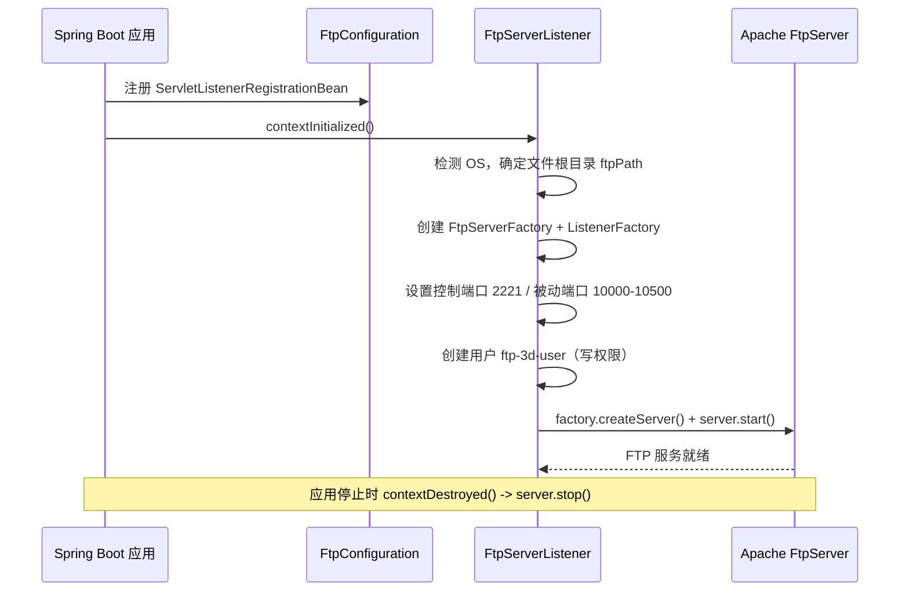
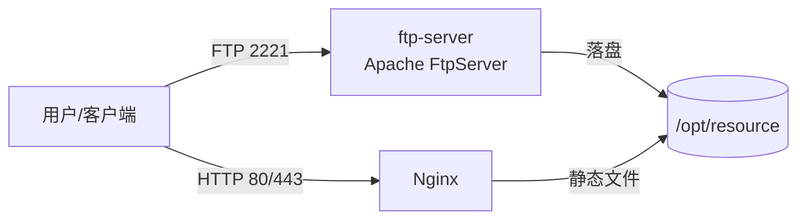

# 架构说明 / Architecture

本文档说明 `springboot-ftp-server` 的设计思路、核心组件与部署形态，供二次开发与运维参考。

## 1. 设计目标 / Design Goals

- **嵌入式**：FTP 服务随 Spring Boot 应用生命周期启动 / 停止，不依赖外部 FTP 守护进程（vsftpd / proftpd 等）。
- **开箱即用**：默认配置即可在本地 / 容器内提供 FTP 文件存储。
- **轻量**：仅引入 `ftpserver-core` 与 `commons-net`，不引入额外框架。

## 2. 组件结构 / Components

```
com.smartcloudx.ftp
└── server
    ├── FtpServerApplication.java        # Spring Boot 启动类
    ├── config
    │   └── FtpConfiguration.java         # 将 FtpServerListener 注册为 Servlet 监听器
    ├── controller
    │   └── FtpController.java            # HTTP 层（健康检查 / 上传入口）
    ├── listener
    │   └── FtpServerListener.java        # 核心：创建并启动 Apache FtpServer
    └── utils
        └── FtpClientUtils.java           # 基于 commons-net 的 FTP 上传演示
```

| 组件 | 职责 |
| --- | --- |
| `FtpServerApplication` | 标准 `@SpringBootApplication` 入口 |
| `FtpConfiguration` | 通过 `ServletListenerRegistrationBean` 把 `FtpServerListener` 挂到 Servlet 容器生命周期 |
| `FtpServerListener` | 实现 `ServletContextListener`：容器初始化时启动 FTP，销毁时停止 FTP |
| `FtpController` | 提供 `GET /`（健康检查）、`POST /upload`（桩，待实现） |
| `FtpClientUtils` | 使用 `commons-net` `FTPClient` 上传文件的演示工具 |

## 3. 启动流程 / Startup Sequence



## 4. 配置参考 / Configuration Reference

当前 FTP 相关参数**硬编码于 `FtpServerListener`**（后续计划外部化为 `application.yml`）：

| 字段 | 默认值 | 说明 |
| --- | --- | --- |
| `ftpPort` | `2221` | FTP 控制端口 |
| 被动端口 | `10000–10500` | `DataConnectionConfigurationFactory.setPassivePorts` |
| `ftpUserName` | `ftp-3d-user` | `BaseUser` 名称 |
| `ftpPassword` | `[ftp@3d@user]` | `BaseUser` 密码（硬编码） |
| `ftpPath` | 见 README「默认配置」 | 按 OS 自动选择 |
| 空闲超时 | `30 * 60` 秒 | `ListenerFactory.setIdleTimeout` |
| HTTP 端口 | `80` | `application.yml` 的 `server.port` |

> ⚠️ 安全提示：上述账号密码为硬编码示例值，生产环境应改为环境变量 / 配置中心读取（见 [SECURITY.md](../SECURITY.md)）。

## 5. 部署形态 / Deployment

仓库提供两种部署方式：

### 5.1 裸机 / 直接运行

```bash
./mvnw clean package
java -jar target/ftp-server-1.0.0.jar
```

### 5.2 Docker + Nginx（推荐用于对外服务）

`docker-compose.yml` 启动两个服务：

- **ftp-server**：映射 `2221` 与 `10000–10500`，挂载 `/opt/resource:/home/resource`
- **nginx**：映射 `80` / `443`，挂载配置、站点、证书目录

典型拓扑：**FTP 负责写入文件，Nginx 指向 `/home/resource` 对外提供静态资源（如图片）的 HTTP 访问**。



> 注意：`Dockerfile` 中 `COPY ftp-server1.0.0.jar ftp-server.jar` 与 Maven 产物名 `ftp-server-1.0.0.jar` 不一致，部署前需重命名 jar 或调整 Dockerfile（已列入路线图）。

## 6. 扩展建议 / Extensibility

- **外部化配置**：将 FTP 参数迁移到 `application.yml`，用 `@Value` / `@ConfigurationProperties` 注入，支持环境变量覆盖。
- **加密传输**：启用 FTPS（`ftpserver-core` 的 SSL 配置）以替代明文 FTP。
- **多用户 / 权限**：基于现有 `UserManager` 扩展多账号与目录级权限。
- **对象存储**：将 `FtpClientUtils` 或上传链路对接 OSS / MinIO 等对象存储。
- **完善上传接口**：实现 `FtpController.upload` 接收 `MultipartFile` 并写入 FTP 根目录。
